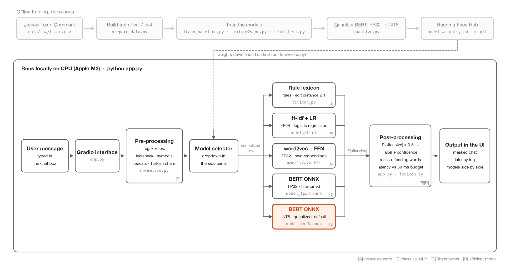
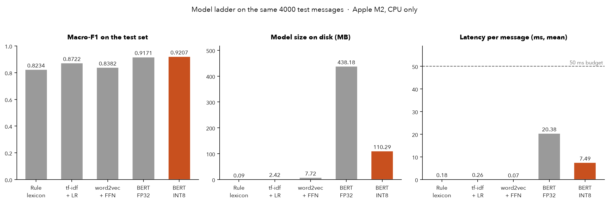

# Real-Time Chat Moderation

SWE015 – Introduction to Large Language Models · Homework "Building an Intelligent Application" · **Use Case 4**

A chat-style application for a gaming platform that labels every message live as **clean** or
**offensive** with a confidence score, masks offensive messages and logs the response time of each
message on a CPU-only machine. The same task is solved by the four models of the ladder plus a rule baseline, all evaluated
on the same held-out test set, and the **quantized Transformer (BERT, INT8)** is the model that runs
inside the application.

> Content warning: the dataset, the lexicon and some examples contain offensive language.

## Quick start

Requires **Python 3.12 or 3.13** (Python 3.14 is not supported yet: `gensim` has no wheel for it and fails to
build) and about 1 GB of free disk space for the model weights. Tested on macOS (Apple M2); Windows commands are provided.

**macOS / Linux**

```bash
git clone https://github.com/zeynepg22/swe015-chat-moderation.git
cd swe015-chat-moderation
python3.13 -m venv .venv && source .venv/bin/activate
pip install -r requirements.txt
python app.py
```

If you use Python 3.12, write `python3.12` instead of `python3.13`. Do not use a plain `python3`: on macOS
it can point to Python 3.14, where `gensim` does not install.

**Windows (PowerShell)**

```powershell
git clone https://github.com/zeynepg22/swe015-chat-moderation.git
cd swe015-chat-moderation
py -3.13 -m venv .venv
.venv\Scripts\activate
pip install -r requirements.txt
python app.py
```

If PowerShell refuses to run the activation script, run `Set-ExecutionPolicy -Scope Process RemoteSigned` once in
the same window and activate again. Use `py -3.12` if you have Python 3.12 instead of 3.13.

On the first run `python app.py` downloads the trained weights from the Hugging Face Hub
([zeynep22/swe015-chat-moderation](https://huggingface.co/zeynep22/swe015-chat-moderation), set in
`src/config.py` as `HF_REPO`) and opens the interface at http://127.0.0.1:7860.
Type a message and press Enter: the message is labelled, masked if offensive, and the side panel shows the
response time of every message and the prediction of every model for the last message.

## Model ladder

| # | Model | Area | Script |
|---|---|---|---|
| 0 | Rule baseline: regex normalization + minimum-edit-distance lexicon matcher | B | `src/normalize.py`, `src/lexicon.py` |
| 1 | Classical baseline: tf-idf + logistic regression | B | `src/train_baseline.py` |
| 2 | Neural network: own word2vec + feedforward network trained with SGD and backpropagation | A (+B) | `src/train_w2v_nn.py` |
| 3 | Transformer: `bert-base-uncased` fine-tuned for classification (FP32, ONNX Runtime) | C | `src/train_bert.py` |
| 4 | Quantized Transformer: the same BERT after dynamic INT8 quantization (ONNX Runtime) | D | `src/quantize.py` |

All models are evaluated on the same held-out test set (`data/processed/test.csv`) by `src/evaluate.py`,
which reports macro-F1 (the classes are imbalanced), model size on disk and the mean latency of a single
message over 200 runs, together with the hardware used.

## Technique map

| Area | Technique | Where it is used |
|---|---|---|
| A · Neural networks | feedforward network, SGD + backpropagation, dropout | `src/train_w2v_nn.py` (model 2) |
| B · Classical NLP | regular expressions, text normalization (leetspeak, symbols, repeated letters, Turkish characters, URLs) | `src/normalize.py` (pre-processing of every model) |
| B · Classical NLP | minimum edit distance (Levenshtein, dynamic programming) | `src/lexicon.py` (rule baseline, masking in the app) |
| B · Classical NLP | tf-idf | `src/train_baseline.py` (model 1) |
| B · Classical NLP | word2vec embeddings trained on my own training messages | `src/train_w2v_nn.py` (input of model 2) |
| C · Transformers | fine-tuning BERT with a classification head, WordPiece tokenizer | `src/train_bert.py` (model 3) |
| D · Efficient models | dynamic INT8 quantization, ONNX Runtime, size / latency / accuracy benchmark against a 50 ms budget | `src/quantize.py`, `src/evaluate.py` (model 4) |

Design note: the homework suggests BERTurk or a multilingual BERT for area C. Because the chosen dataset is
English, the English `bert-base-uncased` is used instead; the pipeline is language-agnostic and only
`BERT_NAME` in `src/config.py` would change for a Turkish dataset.

## Architecture



The diagram is drawn by `docs/draw_architecture.py` (matplotlib). Every box names the file that implements it,
every model states its precision, and the small letters mark the technique area of the homework.

## Results

`python -m src.evaluate` writes the results table to `results/results.md` and `results/results.json`,
and the most confident errors of the deployed model to `results/failures.csv`. `scripts/plot_results.py`
turns the table into `docs/results.png`. Every number in the report comes from my own runs on the
hardware stated in the table.

- Test set: 4000 messages (491 offensive), the same file for every model
- Latency: one message at a time, mean of 200 runs after 10 warm-up runs, normalization and tokenization included
- Hardware: Apple M2, 8 logical cores, Darwin 27.0.0, CPU only
- Latency budget: 50 ms per message

| Model | Precision | Macro-F1 | Accuracy | Offensive recall | Size (MB) | Latency (ms) | p95 (ms) | Within budget |
|---|---|---|---|---|---|---|---|---|
| Rule: edit-distance lexicon | rules | 0.8234 | 0.9350 | 0.5703 | 0.09 | 0.18 | 0.59 | yes |
| Classical: tf-idf + logistic regression | FP64 | 0.8722 | 0.9435 | 0.8004 | 2.42 | 0.26 | 0.30 | yes |
| Neural: word2vec + feedforward network | FP32 | 0.8382 | 0.9267 | 0.7617 | 7.72 | 0.07 | 0.10 | yes |
| Transformer: BERT (FP32, ONNX Runtime) | FP32 | 0.9171 | 0.9625 | 0.9063 | 438.18 | 20.38 | 37.40 | yes |
| Quantized Transformer: BERT (INT8, ONNX Runtime) | INT8 | 0.9207 | 0.9650 | 0.8859 | 110.29 | 7.49 | 13.34 | yes |



**What the table shows**

- **INT8 quantization** shrinks BERT from 438.18 MB to 110.29 MB (about 4x smaller) and cuts the mean
  latency from 20.38 ms to 7.49 ms (p95: 37.40 ms → 13.34 ms). There is no measurable loss in macro-F1. INT8
  scores slightly higher than FP32 (0.9207 vs 0.9171, about 10 more correct messages out of 4000), but that
  gap is at noise level and I do not treat it as an improvement. Offensive recall drops slightly
  (0.9063 → 0.8859).
- **FP32 BERT is already within the 50 ms budget** on the M2. What INT8 adds is headroom: it leaves more of
  the budget free for a slower, shared server CPU.
- **tf-idf + LR beats word2vec + FFN** (0.8722 vs 0.8382). A likely reason: the FFN sees the average of the
  word vectors, and a single offensive word in a message is diluted by the clean words around it.
- **The rule lexicon has low offensive recall** (0.5703): it only finds words from its list, so insults
  without a swear word pass through.
- **BERT is the best model**, but the INT8 model is about 45x larger and about 30x slower than tf-idf + LR.

**Limitation.** BERT INT8 labels undirected profanity such as "shiiit that was close" as clean. The FP32
model gives the same label, so this comes from fine-tuning on Jigsaw, not from quantization.

**Note on pre-processing.** The classical models were trained before Turkish-character folding was added to
`src/normalize.py`; this changes the prediction of 1 of the 4000 test messages for tf-idf + LR and
word2vec + FFN (a false positive) and none for the rule baseline. BERT was trained after the change and is
not affected.

## Reproduce everything from scratch

1. **Data.** Download `train.csv` of the
   [Jigsaw Toxic Comment Classification Challenge](https://www.kaggle.com/competitions/jigsaw-toxic-comment-classification-challenge/data)
   (free Kaggle account required) and place it at `data/raw/train.csv`.
2. **Splits.** `python -m src.prepare_data` keeps chat-length comments (3–300 characters), draws a
   stratified sample of 40,000 messages and splits it 80/10/10 into train / validation / test (seed 42).
   A message is *offensive* if any of the six Jigsaw labels is 1.
3. **Classical baselines.** `python -m src.train_baseline`
4. **Neural network.** `python -m src.train_w2v_nn`
5. **Transformer.** `python -m src.train_bert` (a GPU is recommended). I fine-tuned the model on
   Google Colab (T4 GPU) with `notebooks/train_bert_colab.ipynb`: 2 epochs, learning rate 2e-5, batch size 32,
   12.6 minutes (from `models/bert/train_info.json`), then copied `models/bert/` back into the project.
6. **Quantization.** `python -m src.quantize` exports the fine-tuned model to ONNX (FP32) and creates the INT8 model.
7. **Evaluation.** `python -m src.evaluate` writes `results/results.md`.
8. **Application.** `python app.py`

To publish the weights: `python scripts/upload_models.py <hf-username>/swe015-chat-moderation`, then set
`HF_REPO` in `src/config.py`.

## Repository structure

```
app.py                     Gradio application (runs the quantized BERT by default)
src/config.py              paths and constants (seed, latency budget, threshold, HF repo)
src/normalize.py           regex normalization of noisy chat text
src/lexicon.py             minimum edit distance + lexicon matcher (rule baseline, masking)
src/prepare_data.py        builds the train / val / test splits
src/train_baseline.py      safe-word list + tf-idf + logistic regression
src/train_w2v_nn.py        word2vec + feedforward network
src/train_bert.py          BERT fine-tuning
src/quantize.py            ONNX export + dynamic INT8 quantization
src/models.py              common inference interface of all models
src/evaluate.py            metrics, model size and latency on the test set
src/download.py            downloads the weights from the Hugging Face Hub
scripts/upload_models.py   uploads the weights to the Hugging Face Hub
scripts/plot_results.py    results table -> docs/results.png
docs/draw_architecture.py  architecture diagram -> docs/architecture.png
data/lexicon.txt           offensive-word lexicon of the rule baseline
notebooks/                 Colab notebook for BERT fine-tuning
```

No dataset files and no model weights are stored in this repository (see `.gitignore`).

## Sources

- Data: cjadams, J. Sorensen, J. Elliott, L. Dixon, M. McDonald, nithum, W. Cukierski.
  *Toxic Comment Classification Challenge.* Kaggle, 2018.
  https://kaggle.com/competitions/jigsaw-toxic-comment-classification-challenge
- Pretrained model: J. Devlin, M.-W. Chang, K. Lee, K. Toutanova. *BERT: Pre-training of Deep Bidirectional
  Transformers for Language Understanding.* NAACL 2019. `bert-base-uncased` from the Hugging Face Hub.
- word2vec: T. Mikolov et al. *Efficient Estimation of Word Representations in Vector Space.* 2013
  (gensim implementation).
- Quantization: ONNX Runtime dynamic quantization, https://onnxruntime.ai/docs/performance/model-optimizations/quantization.html
- Lexicon: `data/lexicon.txt`, hand-curated for this homework.
- AI assistance: Claude was used during the development of this project. Details are given on the
  AI Usage slide of the presentation.
